# BookWise – Full-Stack Library Management System

A full-stack library management application built with React, TypeScript, Node.js, Express, Prisma, PostgreSQL and modern web technologies.

**Live Demo:** [BookWise](https://bookwise-books.vercel.app)

## Overview

BookWise is a full-stack library management system designed to simplify the management of library collections, users and borrowing activities.

The application provides separate experiences for administrators and regular users, with dedicated dashboards, library management tools, borrowing workflows and account settings.

Built with a modern frontend and backend architecture, BookWise combines data management, authentication, email integration and cloud-based image storage in one application.

## Screenshots

### Admin Dashboard
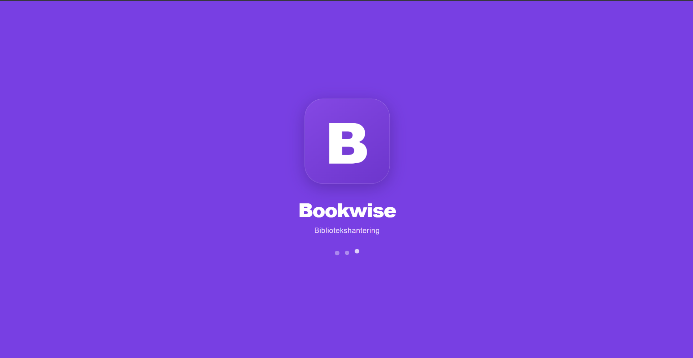

### Library Management
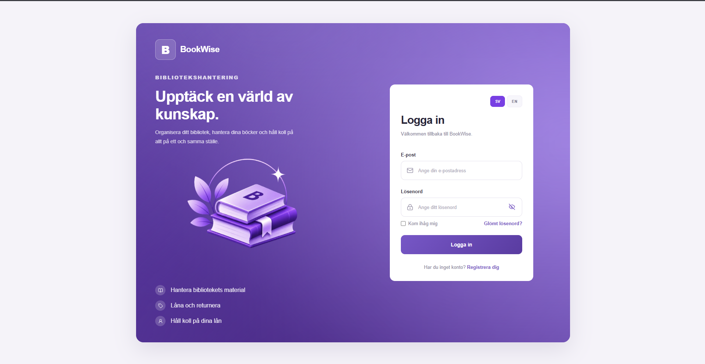

### User Dashboard
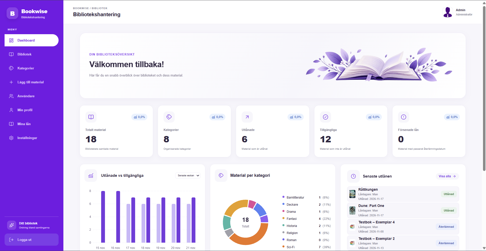

### Borrowing & Returns
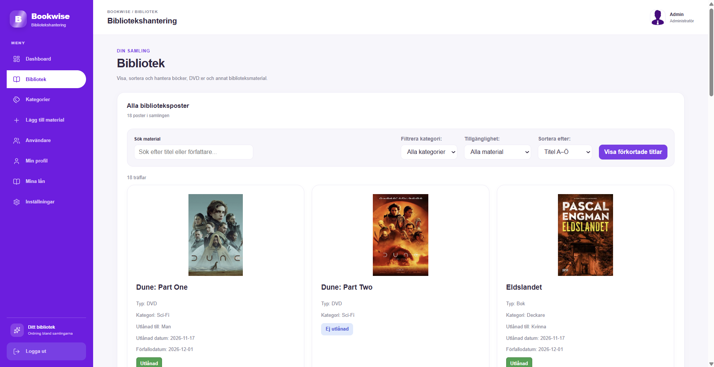

### User Management
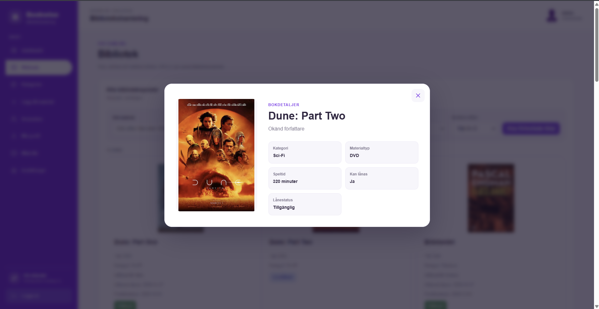

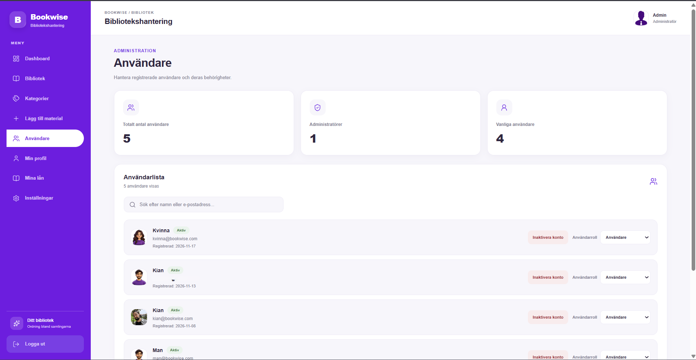
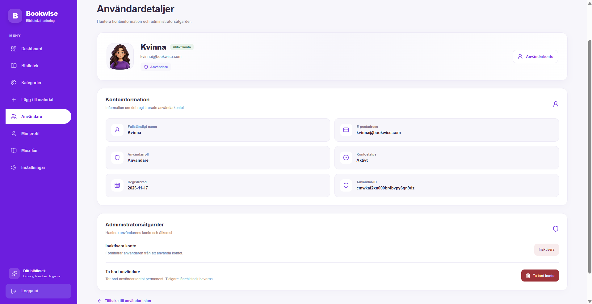
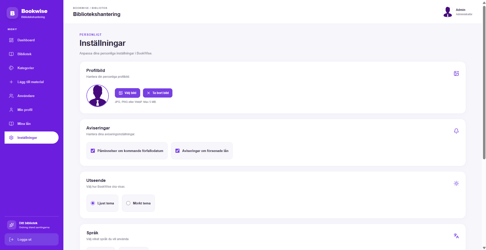
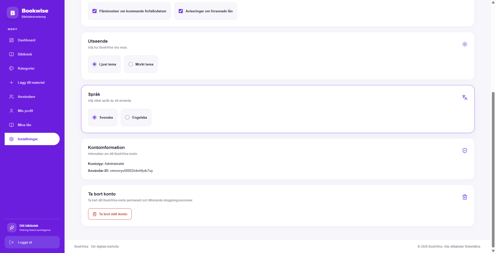
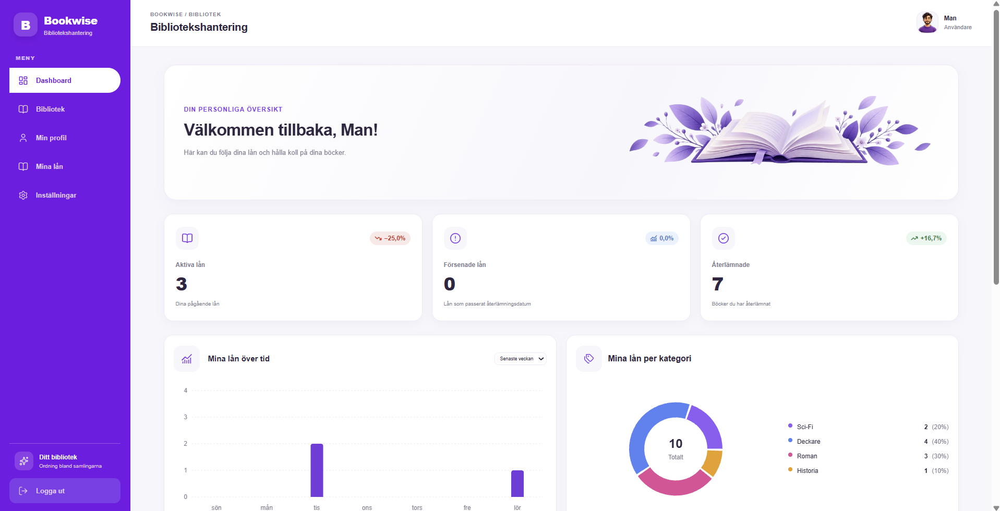
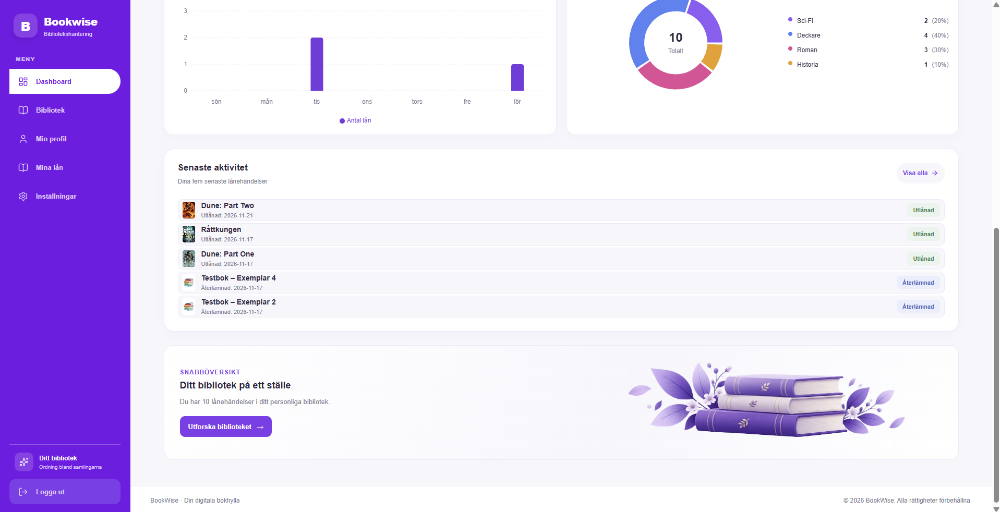
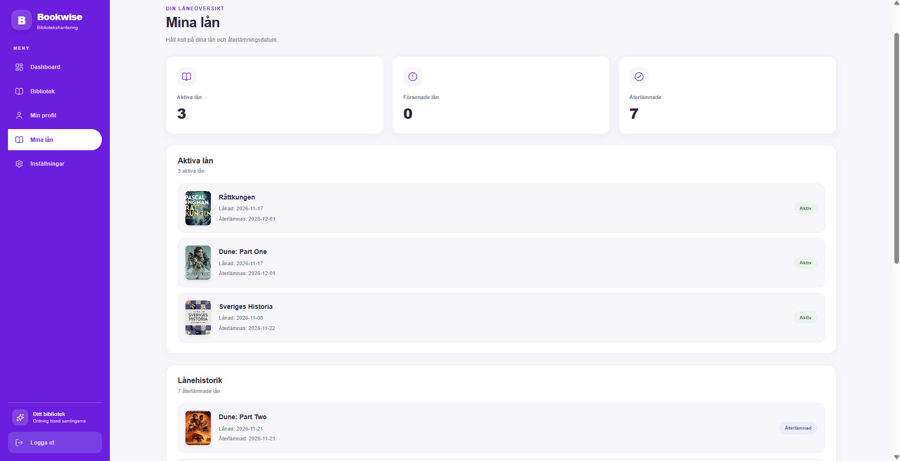
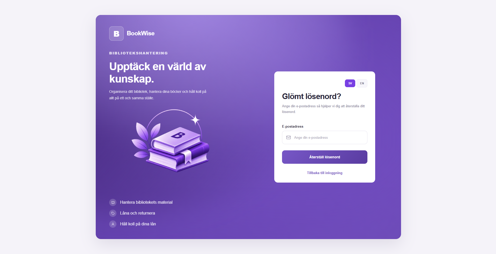
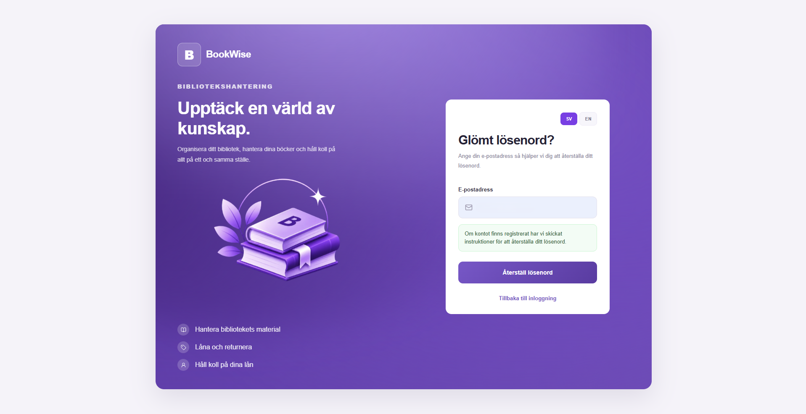
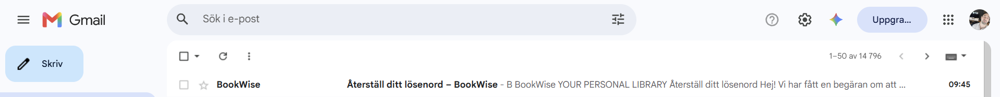
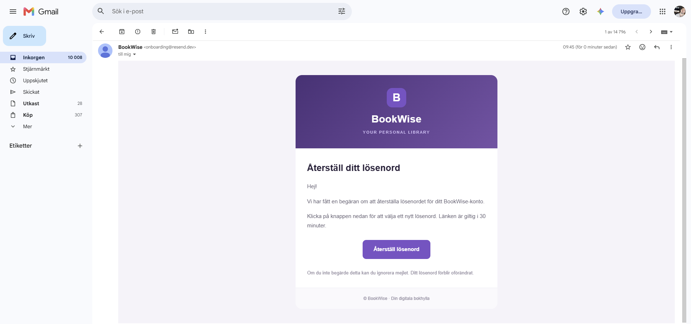
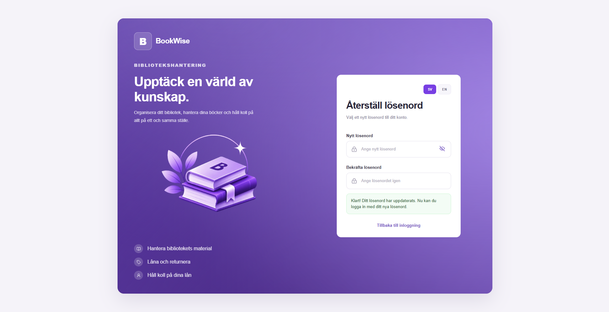


## Features

### Authentication & Account Management
- User registration and login.
- Secure password hashing.
- JWT-based authentication.
- Password reset functionality.
- Password reset emails using Resend.
- Password reset token validation and secure password updates.
- Session revocation after password changes.
- User profile management.

### Library Management
- Create, view, edit and delete library items.
- Support for different library item types, including books, DVDs, audiobooks and reference books.
- Organize library items into categories.
- Upload and manage cover images using Cloudinary.
- Validate image formats and display user-friendly error messages.
- Form validation on both frontend and backend.

### Borrowing & Returns
- Borrow and return library items.
- Register borrower information.
- Track borrowing dates and due dates.
- Display overdue loans.
- View borrowing history.
- Confirmation dialogs for borrowing and returning items.

### Admin Dashboard
- Overview of library statistics.
- Monitor total library items, available items and borrowed items.
- Track overdue loans.
- Visualize available versus borrowed items.
- Display library materials by category.
- Interactive charts with selectable time periods.
- Statistical indicators and animated counters.

### User Dashboard
- Dedicated dashboard for regular users.
- Overview of borrowing activity.
- Access to personal library information and loan details.

### User Management
- Manage registered users.
- User roles and account status.
- Administrative user management functionality.

### Profile & Personalization
- Profile and avatar management.
- Notification preferences.
- Light and dark themes.
- English and Swedish language support.

### User Experience & Reliability
- Responsive interface for different screen sizes.
- Loading states and clear error messages.
- Backend availability error handling.
- Client-side and server-side validation.
- Reusable components and structured application architecture.
- Animated UI interactions and transitions.

## Tech Stack

| Area | Technologies |
|---|---|
| Frontend | React, TypeScript, Vite |
| Styling | CSS |
| UI Icons | Lucide React |
| Animations | Motion |
| Routing | React Router |
| Data Fetching | Axios, React Query |
| Forms & Validation | React Hook Form, Zod |
| Charts | Recharts |
| Backend | Node.js, Express, TypeScript |
| Database | PostgreSQL |
| ORM | Prisma |
| Authentication | JWT, bcrypt |
| Email Service | Resend |
| Image Storage | Cloudinary |
| Deployment | Vercel, Render |

## Project Structure

```text
BookWise/
├── backend/
│   ├── prisma/
│   └── src/
├── frontend/
│   ├── public/
│   └── src/
└── README.md
```

The project is divided into separate frontend and backend applications to maintain a clear separation of responsibilities and support maintainability.

## Getting Started

### Prerequisites

- Node.js
- npm
- PostgreSQL database
- Cloudinary account
- Resend account for email functionality

### Clone the Repository

```bash
git clone https://github.com/Kiankayan/BookWise.git
cd BookWise
```

### Install Dependencies

Install frontend dependencies:

```bash
cd frontend
npm install
```

Install backend dependencies:

```bash
cd ../backend
npm install
```

### Environment Variables

Configure the required environment variables before running the application locally.

**Backend configuration includes:**
- PostgreSQL database connection.
- JWT and authentication secrets.
- Cloudinary credentials.
- Resend API key and email configuration.

**Frontend configuration includes:**
- `VITE_API_URL` – URL pointing to the backend API.

Use the example environment files as references where available. Never commit secret credentials or `.env` files to GitHub.

### Running Locally

Start the backend using the development script defined in `backend/package.json`.

Start the frontend:

```bash
cd frontend
npm run dev
```

Make sure the frontend API configuration points to the running backend.

## Deployment

BookWise is deployed as a full-stack application using cloud services.

- **Frontend:** Vercel
- **Backend:** Render
- **Database:** PostgreSQL
- **Image Storage:** Cloudinary
- **Email Service:** Resend

**Live Application:** [BookWise](https://bookwise-books.vercel.app)

## Project Status

BookWise is a deployed full-stack portfolio project featuring library management, separate admin and user dashboards, authentication, borrowing workflows, image uploads, email integration and database persistence.

The project demonstrates practical experience in designing, developing, integrating and deploying a full-stack web application.

## License

This project is published as a portfolio project. No separate open-source license has been specified.
